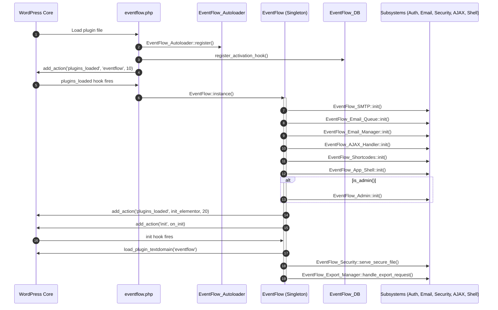
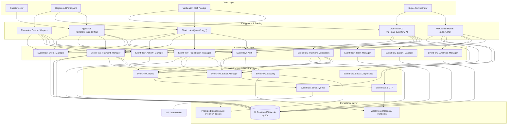
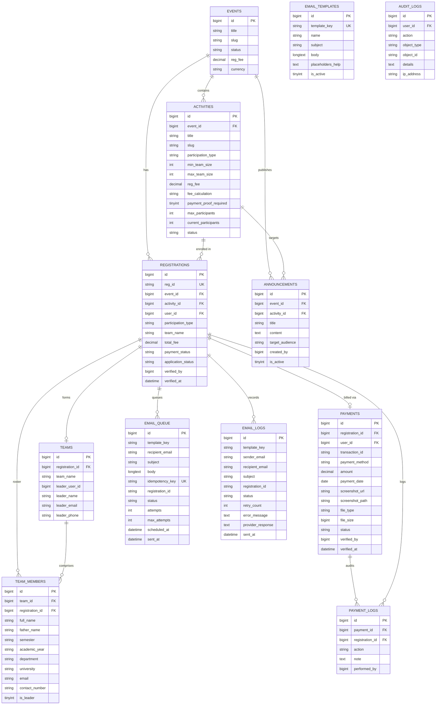
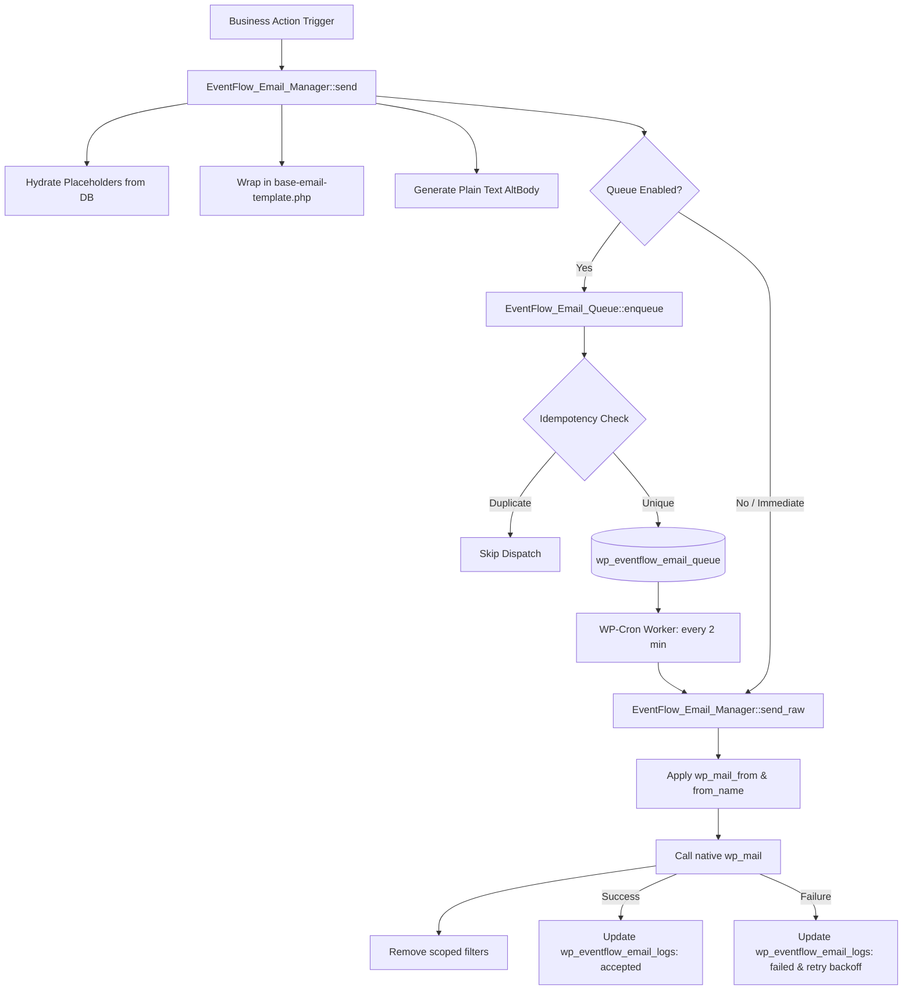

# Project Context & Architecture Reference: EventFlow WordPress Plugin

> **Document Type:** Comprehensive Technical Architecture, Codebase Audit & Developer Reference  
> **Plugin Name:** EventFlow – Advanced Event Registration & Management System  
> **Plugin Version:** 4.0.2  
> **Target Platform:** WordPress 5.8+ (Fully verified on WordPress 6.x) | PHP 7.4 to 8.3  
> **Context Target:** Developers, Security Auditors, DevOps Engineers, and Autonomous AI Coding Agents  
> **Root Directory:** `c:\Users\HT COMPUTERS\Desktop\SIBACOM PLUGIN`  

---

## 1. Project Overview

**EventFlow** is an enterprise-grade, full-lifecycle event management, competition tracking, dynamic team formation, financial payment verification, and attendee portal plugin for WordPress.

Originally customized for university-scale technology championships (specifically engineered for the **SIBACOM** annual championship hosted by the **Department of Computer Science & Executive Society at Sukkur IBA University**), EventFlow is designed to completely decouple the operational management of events from the standard WordPress administrative backoffice (`/wp-admin/`).

### Key Highlights
- **Standalone App Experience (Theme Bypass):** Built with a dedicated App Shell (`EventFlow_App_Shell`) that completely eliminates active WordPress theme headers, navigation bars, site logos, sidebars, and footers, transforming the WordPress installation into a full-screen, focused web application.
- **Dual Management Interface:** Provides both a WordPress Admin backoffice (`wp-admin/admin.php?page=eventflow-dashboard`) and a standalone, zero-admin **Frontend Staff Command Center** (`/event-dashboard/`) allowing event organizers, financial evaluators, and judges to operate securely from the frontend without administrative WordPress accounts.
- **Split-Screen Authentication:** Implements a reference-accurate, animated split-screen authentication portal on a mint background (`#F0F7F5`) featuring teal gradients (`#36B49F` to `#27A991`), brand logo placement, mode transitions (Sign In, Create Account, Password Recovery), and rate-limited authentication.
- **Dynamic Team Registration Engine:** Supports Individual (Solo) and Team participation modes with configurable minimum/maximum team sizes, live fee calculation (*Per Team* vs. *Per Person*), duplicate member validation, and captures 7 mandatory participant details per member.
- **In-App Zero-Download Payment Proof Inspector:** Features an interactive canvas and SVG/PDF preview modal enabling verification staff to zoom in/out, rotate 360°, pan/drag, and review uploaded transaction screenshots side-by-side with participant metadata.
- **Pure WordPress Native Email Dispatch Engine:** Employs an RFC-compliant notification system powered by `wp_mail()` with scoped sender filters (`info@portal.sibacom.tech`), dynamic HTML layouts, plain-text MIME alternatives, asynchronous background queuing with idempotency locking, and delivery diagnostics.

---

## 2. Plugin Purpose and Objectives

### Primary Objectives
1. **Eliminate Operational Friction:** Eliminate the requirement for event coordinators, judges, and volunteer student staff to navigate the WordPress admin dashboard or hold full administrative accounts.
2. **Streamline Competitions & Hackathons:** Enable organizers to host complex multi-track events with diverse competition categories (e.g., *Speed Programming*, *Autonomous Robotics*, *UI/UX Designathons*), each having distinct participation types, eligibility rules, deadlines, capacities, and fee structures.
3. **Automate Financial Reconciliation:** Support regional Pakistani and international payment options (Bank Alfalah, IBFT/1Link, Raast, JazzCash, Easypaisa, and merchant QR codes) with proof-of-payment image/PDF uploads, audit logging, and financial ledger tracking.
4. **Deliver Turnkey Instant Activation:** On activation, automatically create 12 relational database tables, register 6 custom user roles with 15 granular capabilities, seed default events, sample competitions, 18 notification templates, and provision 5 dedicated WordPress pages.

---

## 3. Technology Stack

### Backend
- **Core Platform:** WordPress 5.8+ (GPLv2 or later)
- **Programming Language:** PHP 7.4, 8.0, 8.1, 8.2, 8.3
- **Database Engine:** MySQL 5.7+ / MySQL 8.0+ / MariaDB 10.3+ using WordPress `dbDelta()` schema orchestration
- **Object-Oriented Architecture:** Singleton orchestrator pattern, SPL Class Autoloader (`EventFlow_Autoloader`), static separation of concerns
- **Cryptographic Security:** OpenSSL `aes-256-cbc` symmetric credential encryption with salt hashing for stored SMTP passwords; fallback XOR obfuscation

### Frontend
- **JavaScript Engine:** Vanilla ES6+ and jQuery 3.x
- **Visualization & Charts:** Native HTML5 Canvas rendering engine (`eventflow-charts.js`) with zero external CDN dependencies
- **Styling Architecture:** Pure CSS3 with CSS Custom Properties (Variables: `--ef-primary: #36B49F;`, `--ef-secondary: #27A991;`), scoped under `.eventflow-app` and `.ef-staff-app`
- **Interactive UI Components:** Split-screen auth state flipper, SVG/Canvas interactive image viewer (zoom, rotate, drag/pan), live countdown timer, clipboard API connectors, dynamic team member field generators

### Integrations
- **Elementor:** Compatible with Elementor Free and Pro (registers `eventflow-elements` category and 5 dedicated widgets)
- **Mailing Transports:** WordPress Native `wp_mail()`, PHPMailer hook integration, direct socket SMTP probe with TLS handshake verification
- **Scheduler:** WordPress Cron API (`wp_schedule_event`) with custom 1-minute and 2-minute recurring intervals

---

## 4. Complete Directory Structure

```text
SIBACOM PLUGIN/
├── CONTEXT.md                               # This comprehensive architecture & developer reference
├── CONFIGURATION_GUIDE.md                   # Operational admin settings & configuration reference
├── DATABASE_SCHEMA.md                       # High-level database schema documentation (legacy 11-table ref)
├── ELEMENTOR_INTEGRATION.md                 # Elementor widget usage, controls, and layout guide
├── INSTALLATION_GUIDE.md                    # Turnkey installation, page setup, and activation guide
├── README.md                                # Executive summary and feature overview
├── ROLES_AND_PERMISSIONS.md                 # RBAC matrix and capability allocation guide
├── SHORTCODES_GUIDE.md                      # Shortcode syntax, attributes, and embedding guide
├── TESTING_REPORT.md                        # Verification and end-to-end test execution log
├── TROUBLESHOOTING.md                       # Maintenance, diagnostics, and common resolutions
├── eventflow-v4.0.2.zip                     # Packaged installable archive v4.0.2
├── eventflow.zip                            # Packaged installable archive (latest)
│
├── eventflow/                               # Production WordPress Plugin Source Directory
│   ├── eventflow.php                        # Main entrypoint, plugin headers, constants, hooks
│   ├── README.md                            # Internal plugin readme
│   ├── uninstall.php                        # Cleanup handler: drops 12 tables, options, roles
│   │
│   ├── admin/                               # WordPress Admin Backoffice Subsystem
│   │   ├── class-admin.php                  # Menu registry, asset enqueuer, POST actions handler
│   │   ├── index.php                        # Directory browsing silence guard
│   │   └── views/                           # Admin view templates
│   │       ├── index.php                    # Silence guard
│   │       ├── view-activities.php          # Competition management (CRUD, capacity, fee limits)
│   │       ├── view-dashboard.php           # Admin command center, KPI counters, charts
│   │       ├── view-emails.php              # 5-tab email suite (Settings, Templates, Queue, Logs, Diagnostics)
│   │       ├── view-events.php              # Event scheduling, deadlines, branding assets
│   │       ├── view-export.php              # Data export dashboard (CSV, Excel, Printable)
│   │       ├── view-logs.php                # Security audit and system activity logs
│   │       ├── view-payments.php            # Administrative payment verification view
│   │       ├── view-registrations.php       # Attendee & team applications management
│   │       ├── view-settings.php            # Core plugin options, gateway toggles, app shell settings
│   │       └── view-staff.php               # Staff accounts, roles & permission assignments
│   │
│   ├── assets/                              # Static Assets
│   │   ├── index.php                        # Silence guard
│   │   ├── css/                             # Stylesheets
│   │   │   ├── index.php                    # Silence guard
│   │   │   ├── eventflow-admin.css          # WP-Admin dashboard UI styles (22.4 KB)
│   │   │   ├── eventflow-frontend.css       # Participant portal, landing, and auth styles (68.8 KB)
│   │   │   ├── eventflow-receipt.css        # Printable official registration voucher styles (3.7 KB)
│   │   │   └── eventflow-staff-dashboard.css# Frontend staff command center styles (8.1 KB)
│   │   ├── js/                              # JavaScript Modules
│   │   │   ├── index.php                    # Silence guard
│   │   │   ├── eventflow-admin.js           # Backoffice interactive logic & modals (18.5 KB)
│   │   │   ├── eventflow-charts.js          # Native HTML5 Canvas charting engine (8.0 KB)
│   │   │   ├── eventflow-frontend.js        # Auth transitions, team builder, live events UI (36.4 KB)
│   │   │   ├── eventflow-payment-preview.js # Proof inspector: zoom, rotate, pan, PDF preview (5.7 KB)
│   │   │   └── eventflow-staff-dashboard.js # Frontend command center AJAX handlers (11.1 KB)
│   │   └── images/                          # Visual Branding & Fallback SVGs
│   │       ├── default-banner.svg           # Hero background placeholder
│   │       ├── default-qr.svg               # Fallback merchant payment QR code
│   │       ├── logo.svg                     # Fallback EventFlow logo
│   │       └── branding/                    # Sukkur IBA University & Department Branding
│   │           ├── academic_block3_clean.jpg
│   │           ├── academic_block3_clean_v2.jpg
│   │           ├── academic_block3_source.webp
│   │           ├── cse_dept_logo.jpg
│   │           ├── cse_society_logo.png
│   │           ├── cse_society_logo_transparent.png
│   │           ├── cse_society_logo_white.png
│   │           ├── hero.png
│   │           ├── sisc_logo.jpg
│   │           ├── sukkur_iba_block3.jpg
│   │           ├── sukkur_iba_block3_illustrated.jpg
│   │           ├── sukkur_iba_block3_photo.jpg
│   │           ├── sukkur_iba_logo.png
│   │           └── sukkur_iba_white_logo.png
│   │
│   ├── elementor/                           # Elementor Integration Subsystem
│   │   ├── index.php                        # Silence guard
│   │   └── widgets/                         # Custom Elementor Widget Classes
│   │       ├── index.php                    # Silence guard
│   │       ├── class-widget-activities.php  # [❖] EventFlow Activities Grid Widget
│   │       ├── class-widget-auth.php        # [❖] EventFlow Login & Register Widget
│   │       ├── class-widget-dashboard.php   # [❖] EventFlow Participant Dashboard Widget
│   │       ├── class-widget-landing.php     # [❖] EventFlow Landing Hero Widget
│   │       └── class-widget-staff-dashboard.php # [❖] EventFlow Staff Portal Widget
│   │
│   ├── includes/                            # Core Logic & Architectural Modules
│   │   ├── index.php                        # Silence guard
│   │   ├── class-activity-manager.php       # Activity CRUD, track limits, fee calculations
│   │   ├── class-ajax-handler.php           # Centralized AJAX endpoint router (27+ endpoints)
│   │   ├── class-analytics-manager.php      # Live KPIs, daily trend calculators, distributions
│   │   ├── class-app-shell.php              # Full-page standalone mode, template interceptor
│   │   ├── class-auth.php                   # Participant registration, login, rate limiting
│   │   ├── class-autoloader.php             # PSR-style autoloader with conventional fallback
│   │   ├── class-db.php                     # 12-table DDL schema, migrations, seed generators
│   │   ├── class-elementor.php              # Category & widget loader for Elementor
│   │   ├── class-email-diagnostics.php      # Mail environment, PHP transport & DNS inspector
│   │   ├── class-email-manager.php          # Central notification engine, scoped wp_mail filters
│   │   ├── class-email-queue.php            # Background email queue, idempotency, WP-Cron worker
│   │   ├── class-event-manager.php          # Event scheduling, status resolver, active event logic
│   │   ├── class-eventflow.php              # Core Singleton orchestrator & hook binder
│   │   ├── class-export-manager.php         # Multi-format reporting engine (CSV, Excel, HTML)
│   │   ├── class-participant-portal.php     # View alias wrapper for participant portal
│   │   ├── class-payment-manager.php        # Payment gateway settings & receipt file uploader
│   │   ├── class-payment-verification.php   # Verification listing, approval, rejection, audit
│   │   ├── class-registration-manager.php   # Registration lifecycle, IDs, solo/team processing
│   │   ├── class-roles.php                  # RBAC manager (6 roles, 15 custom capabilities)
│   │   ├── class-security.php               # Nonce verification, capabilities, proxy file server
│   │   ├── class-shortcodes.php             # 11 shortcodes registry, asset enqueue, dynamic URLs
│   │   ├── class-smtp.php                   # Real SMTP transport, credential encryption, tester
│   │   ├── class-staff-dashboard.php        # View alias wrapper for staff command center
│   │   └── class-team-manager.php           # Team & member rosters, 7 member fields validator
│   │
│   ├── languages/                           # Internationalization & Translations
│   │   ├── index.php                        # Silence guard
│   │   └── eventflow.pot                    # Gettext translation template
│   │
│   └── templates/                           # Presentation & View Templates
│       ├── index.php                        # Silence guard
│       ├── emails/                          # Email Templates
│       │   ├── index.php                    # Silence guard
│       │   └── base-email-template.php      # Responsive branded HTML email layout
│       └── frontend/                        # Frontend User Interfaces
│           ├── index.php                    # Silence guard
│           ├── activity-list.php            # Public competition grid template
│           ├── activity-single.php          # Dedicated single activity detail template
│           ├── app-shell.php                # Clean standalone HTML5 app wrapper
│           ├── auth-home.php                # Split-screen teal/white authentication landing
│           ├── auth-page.php                # Tabbed embeddable authentication card
│           ├── landing-page.php             # Public event landing hero & track list
│           ├── participant-dashboard.php    # Live events discovery & application management
│           ├── payment-submission.php       # Bank info, QR scanner & receipt upload dropzone
│           ├── receipt-template.php         # Official printable confirmation pass & voucher
│           ├── staff-dashboard.php          # Frontend staff command center (60.7 KB)
│           └── tracking-page.php            # Public registration status lookup tool
│
└── tests/                                   # Standalone Test Suites (Mock Harnesses)
    ├── test-email-system.php                # Unit/integration test suite for email engine (28.1 KB)
    ├── test-phpmailer-init.php              # PHPMailer hook & encryption assertion test (3.1 KB)
    └── test-registration-system.php         # Full registration & payment lifecycle test suite (49.8 KB)
```

---

## 5. Plugin Architecture

### Initialization Lifecycle

The plugin follows a strictly orchestrated sequence attached to native WordPress hooks:



### Component Interaction Architecture



---

## 6. Core Modules

| Module Name | Source File | Responsibility |
|---|---|---|
| `EventFlow` | [`eventflow/includes/class-eventflow.php`](file:///c:/Users/HT%20COMPUTERS/Desktop/SIBACOM%20PLUGIN/eventflow/includes/class-eventflow.php#L10) | Main Singleton orchestrator. Binds `init`, `wp_head`, `admin_head`, handles Elementor detection, and injects dynamic CSS brand variables. |
| `EventFlow_Autoloader` | [`eventflow/includes/class-autoloader.php`](file:///c:/Users/HT%20COMPUTERS/Desktop/SIBACOM%20PLUGIN/eventflow/includes/class-autoloader.php#L10) | Custom class autoloader mapping 24 core classes explicitly with a conventional fallback directory resolver. |
| `EventFlow_DB` | [`eventflow/includes/class-db.php`](file:///c:/Users/HT%20COMPUTERS/Desktop/SIBACOM%20PLUGIN/eventflow/includes/class-db.php#L10) | Manages 12 custom database tables, incremental schema migrations (`migrate_tables`), activation routines, seeding, and directory protection. |
| `EventFlow_Roles` | [`eventflow/includes/class-roles.php`](file:///c:/Users/HT%20COMPUTERS/Desktop/SIBACOM%20PLUGIN/eventflow/includes/class-roles.php#L10) | Defines and registers 6 custom roles and 15 capabilities; maps capabilities to native WordPress `administrator`. |
| `EventFlow_Security` | [`eventflow/includes/class-security.php`](file:///c:/Users/HT%20COMPUTERS/Desktop/SIBACOM%20PLUGIN/eventflow/includes/class-security.php#L10) | Nonce verification, capability checking, client IP extraction, transient rate-limiting, audit logging, and secure file streaming proxy. |
| `EventFlow_Auth` | [`eventflow/includes/class-auth.php`](file:///c:/Users/HT%20COMPUTERS/Desktop/SIBACOM%20PLUGIN/eventflow/includes/class-auth.php#L10) | AJAX authentication, account creation, duplicate user checks, role-based login redirections, and password reset handling. |
| `EventFlow_Event_Manager` | [`eventflow/includes/class-event-manager.php`](file:///c:/Users/HT%20COMPUTERS/Desktop/SIBACOM%20PLUGIN/eventflow/includes/class-event-manager.php#L10) | Event retrieval, active event resolution, deadline validation, registration status badges, and event updates. |
| `EventFlow_Activity_Manager` | [`eventflow/includes/class-activity-manager.php`](file:///c:/Users/HT%20COMPUTERS/Desktop/SIBACOM%20PLUGIN/eventflow/includes/class-activity-manager.php#L10) | Competition track CRUD, eligibility checks, capacity enforcement, participant counter increments, and fee calculation. |
| `EventFlow_Registration_Manager` | [`eventflow/includes/class-registration-manager.php`](file:///c:/Users/HT%20COMPUTERS/Desktop/SIBACOM%20PLUGIN/eventflow/includes/class-registration-manager.php#L10) | Processes Solo/Team registrations, generates unique IDs (`EF-YYYY-XXXXX`), links receipts, and manages lifecycle statuses. |
| `EventFlow_Team_Manager` | [`eventflow/includes/class-team-manager.php`](file:///c:/Users/HT%20COMPUTERS/Desktop/SIBACOM%20PLUGIN/eventflow/includes/class-team-manager.php#L10) | Creates team records, persists 7 mandatory fields per member, validates min/max boundaries, and handles member profile updates. |
| `EventFlow_Payment_Manager` | [`eventflow/includes/class-payment-manager.php`](file:///c:/Users/HT%20COMPUTERS/Desktop/SIBACOM%20PLUGIN/eventflow/includes/class-payment-manager.php#L10) | Gateway configurations (Bank, JazzCash, Easypaisa, Raast, QR), receipt uploads (5MB max; JPG/PNG/PDF), and submission processing. |
| `EventFlow_Payment_Verification` | [`eventflow/includes/class-payment-verification.php`](file:///c:/Users/HT%20COMPUTERS/Desktop/SIBACOM%20PLUGIN/eventflow/includes/class-payment-verification.php#L10) | Staff verification backend: paginated query listing, approval (`verify_payment`), rejection (`reject_payment`), and re-upload requests. |
| `EventFlow_Email_Manager` | [`eventflow/includes/class-email-manager.php`](file:///c:/Users/HT%20COMPUTERS/Desktop/SIBACOM%20PLUGIN/eventflow/includes/class-email-manager.php#L10) | Centralized notification engine with scoped sender filters (`info@portal.sibacom.tech`), dynamic placeholders, and layout rendering. |
| `EventFlow_SMTP` | [`eventflow/includes/class-smtp.php`](file:///c:/Users/HT%20COMPUTERS/Desktop/SIBACOM%20PLUGIN/eventflow/includes/class-smtp.php#L10) | Custom SMTP delivery via PHPMailer hooks, OpenSSL AES-256-CBC credential encryption, plugin conflict detection, and live socket probes. |
| `EventFlow_Email_Queue` | [`eventflow/includes/class-email-queue.php`](file:///c:/Users/HT%20COMPUTERS/Desktop/SIBACOM%20PLUGIN/eventflow/includes/class-email-queue.php#L10) | Database queue (`wp_eventflow_email_queue`), idempotency key deduplication, exponential backoff retries, and WP-Cron automation. |
| `EventFlow_Email_Diagnostics` | [`eventflow/includes/class-email-diagnostics.php`](file:///c:/Users/HT%20COMPUTERS/Desktop/SIBACOM%20PLUGIN/eventflow/includes/class-email-diagnostics.php#L10) | Comprehensive delivery diagnostics inspecting `wp_mail`, PHP `mail()`, server MTA, and DNS records (SPF, DKIM, DMARC) for `portal.sibacom.tech`. |
| `EventFlow_Export_Manager` | [`eventflow/includes/class-export-manager.php`](file:///c:/Users/HT%20COMPUTERS/Desktop/SIBACOM%20PLUGIN/eventflow/includes/class-export-manager.php#L10) | Multi-format data export engine generating CSV (with UTF-8 BOM), Excel (.xls), and printable HTML/PDF reports. |
| `EventFlow_Analytics_Manager` | [`eventflow/includes/class-analytics-manager.php`](file:///c:/Users/HT%20COMPUTERS/Desktop/SIBACOM%20PLUGIN/eventflow/includes/class-analytics-manager.php#L10) | Real-time SQL aggregations for KPIs, 14-day daily velocity trends, activity distribution, and status breakdowns. |
| `EventFlow_Shortcodes` | [`eventflow/includes/class-shortcodes.php`](file:///c:/Users/HT%20COMPUTERS/Desktop/SIBACOM%20PLUGIN/eventflow/includes/class-shortcodes.php#L10) | Registry for 11 shortcodes, dynamic page URL resolvers, and script/style enqueuer with localization. |
| `EventFlow_AJAX_Handler` | [`eventflow/includes/class-ajax-handler.php`](file:///c:/Users/HT%20COMPUTERS/Desktop/SIBACOM%20PLUGIN/eventflow/includes/class-ajax-handler.php#L10) | Central controller registering and processing 27+ AJAX actions with strict nonce verification and capability enforcement. |
| `EventFlow_App_Shell` | [`eventflow/includes/class-app-shell.php`](file:///c:/Users/HT%20COMPUTERS/Desktop/SIBACOM%20PLUGIN/eventflow/includes/class-app-shell.php#L10) | Filters `template_include` (priority 999) and `template_redirect`, suppressing theme markup and rendering standalone views. |
| `EventFlow_Elementor` | [`eventflow/includes/class-elementor.php`](file:///c:/Users/HT%20COMPUTERS/Desktop/SIBACOM%20PLUGIN/eventflow/includes/class-elementor.php#L10) | Registers `eventflow-elements` category and 5 native Elementor widgets. |
| `EventFlow_Admin` | [`eventflow/admin/class-admin.php`](file:///c:/Users/HT%20COMPUTERS/Desktop/SIBACOM%20PLUGIN/eventflow/admin/class-admin.php#L10) | Admin menu controller registering 10 subpages, enqueuing backoffice assets, and handling native form submissions. |

---

## 7. Features and Functionality

### 1. Split-Screen Authentication & Homepage Takeover
- **Implementation:** [`EventFlow_App_Shell`](file:///c:/Users/HT%20COMPUTERS/Desktop/SIBACOM PLUGIN/eventflow/includes/class-app-shell.php#L10), [`EventFlow_Auth`](file:///c:/Users/HT%20COMPUTERS/Desktop/SIBACOM PLUGIN/eventflow/includes/class-auth.php#L10), [`templates/frontend/auth-home.php`](file:///c:/Users/HT%20COMPUTERS/Desktop/SIBACOM PLUGIN/eventflow/templates/frontend/auth-home.php).
- **Status:** **Fully Implemented**.
- **Details:** If enabled in settings (`eventflow_standalone_mode` and `eventflow_takeover_homepage`), visits to `/` present a split-screen layout. Logged-out users see branding and Sign In / Register / Forgot Password forms. Logged-in participants are redirected to `/participant-dashboard/`, and staff members are routed to `/event-dashboard/`.

### 2. Live Events Discovery & Participant Portal
- **Implementation:** [`EventFlow_Shortcodes::render_dashboard()`](file:///c:/Users/HT%20COMPUTERS/Desktop/SIBACOM PLUGIN/eventflow/includes/class-shortcodes.php#L139), [`templates/frontend/participant-dashboard.php`](file:///c:/Users/HT%20COMPUTERS/Desktop/SIBACOM PLUGIN/eventflow/templates/frontend/participant-dashboard.php).
- **Status:** **Fully Implemented**.
- **Details:** Provides authenticated participants with tabs for *Live Events*, *My Registrations*, and *Notifications*. Displays registered tracks, real-time application and payment badges, payment submission links, and receipt voucher generators.

### 3. Dynamic Team Registration Builder (7 Mandatory Fields)
- **Implementation:** [`EventFlow_Registration_Manager::process_registration()`](file:///c:/Users/HT%20COMPUTERS/Desktop/SIBACOM PLUGIN/eventflow/includes/class-registration-manager.php#L42), [`EventFlow_Team_Manager`](file:///c:/Users/HT%20COMPUTERS/Desktop/SIBACOM PLUGIN/eventflow/includes/class-team-manager.php#L10), [`templates/frontend/registration-form.php`](file:///c:/Users/HT%20COMPUTERS/Desktop/SIBACOM PLUGIN/eventflow/templates/frontend/registration-form.php).
- **Status:** **Fully Implemented**.
- **Details:** Solo and Team switcher. Dynamic client-side "+ Add Team Member" card generator. Captures 7 mandatory fields per participant:
  1. Full Name (`full_name`)
  2. Father's Name (`father_name`)
  3. Current Semester (`semester`)
  4. Academic Year / Batch (`academic_year`)
  5. Department (`department`)
  6. University / Institution (`university`)
  7. Email Address (`email`) & WhatsApp / Contact Phone (`contact_number`)
- Validates minimum/maximum team size and checks for duplicate emails and phone numbers both client-side and server-side.

### 4. Financial Payment Submission & Gateway Information
- **Implementation:** [`EventFlow_Payment_Manager`](file:///c:/Users/HT%20COMPUTERS/Desktop/SIBACOM PLUGIN/eventflow/includes/class-payment-manager.php#L10), [`templates/frontend/payment-submission.php`](file:///c:/Users/HT%20COMPUTERS/Desktop/SIBACOM PLUGIN/eventflow/templates/frontend/payment-submission.php).
- **Status:** **Fully Implemented**.
- **Details:** Displays enabled gateways (Bank Alfalah, IBFT/1Link, Raast, JazzCash, Easypaisa) with one-click copy buttons for Account Number and IBAN. Displays payment QR codes. Accepts receipt uploads (JPG, PNG, PDF; max 5MB) into `/wp-content/uploads/eventflow-secure/`.

### 5. In-App Zero-Download Payment Proof Inspector
- **Implementation:** [`EventFlow_Security::serve_secure_file()`](file:///c:/Users/HT%20COMPUTERS/Desktop/SIBACOM PLUGIN/eventflow/includes/class-security.php#L123), [`eventflow-payment-preview.js`](file:///c:/Users/HT%20COMPUTERS/Desktop/SIBACOM PLUGIN/eventflow/assets/js/eventflow-payment-preview.js), [`templates/frontend/staff-dashboard.php`](file:///c:/Users/HT%20COMPUTERS/Desktop/SIBACOM PLUGIN/eventflow/templates/frontend/staff-dashboard.php).
- **Status:** **Fully Implemented**.
- **Details:** Interactive modal viewer allowing verification staff to inspect payment screenshots in-app without downloading them to disk. Features zoom in/out (`+25%` / `-25%`), rotation (`90°`), drag-to-pan, and embedded PDF preview. Links are protected by one-time nonces via `?eventflow_action=view_proof&payment_id=X&_wpnonce=Y`.

### 6. Frontend Staff Command Center
- **Implementation:** [`EventFlow_Shortcodes::render_staff_dashboard()`](file:///c:/Users/HT%20COMPUTERS/Desktop/SIBACOM PLUGIN/eventflow/includes/class-shortcodes.php#L265), [`templates/frontend/staff-dashboard.php`](file:///c:/Users/HT%20COMPUTERS/Desktop/SIBACOM PLUGIN/eventflow/templates/frontend/staff-dashboard.php).
- **Status:** **Fully Implemented**.
- **Details:** Dedicated frontend portal (`/event-dashboard/`) restricted to staff roles (`eventflow_staff_access`). Provides real-time KPI cards, HTML5 canvas charts, registrations review, payment verification inspector, activity CRUD, announcements broadcast, and data export without accessing `wp-admin`.

### 7. Automated Email Notification Engine & Background Queue
- **Implementation:** [`EventFlow_Email_Manager`](file:///c:/Users/HT%20COMPUTERS/Desktop/SIBACOM PLUGIN/eventflow/includes/class-email-manager.php#L10), [`EventFlow_Email_Queue`](file:///c:/Users/HT%20COMPUTERS/Desktop/SIBACOM PLUGIN/eventflow/includes/class-email-queue.php#L10), [`EventFlow_SMTP`](file:///c:/Users/HT%20COMPUTERS/Desktop/SIBACOM PLUGIN/eventflow/includes/class-smtp.php#L10), [`EventFlow_Email_Diagnostics`](file:///c:/Users/HT%20COMPUTERS/Desktop/SIBACOM PLUGIN/eventflow/includes/class-email-diagnostics.php#L10).
- **Status:** **Fully Implemented** (with 1 specific bug in `handle_forgot_password` documented in Section 20).
- **Details:** Automated triggers across 18 templates. Supports asynchronous queuing with idempotency keys, exponential retry backoff (up to 3 retries), scoped sender identity (`info@portal.sibacom.tech`), and deliverability diagnostics for `portal.sibacom.tech`.

### 8. Official Confirmation Voucher & Receipt
- **Implementation:** [`templates/frontend/receipt-template.php`](file:///c:/Users/HT%20COMPUTERS/Desktop/SIBACOM PLUGIN/eventflow/templates/frontend/receipt-template.php), [`assets/css/eventflow-receipt.css`](file:///c:/Users/HT%20COMPUTERS/Desktop/SIBACOM PLUGIN/eventflow/assets/css/eventflow-receipt.css).
- **Status:** **Fully Implemented**.
- **Details:** Generates a printable participation pass and voucher with barcode simulation, verification stamp, event logo, team roster, and transaction details.

### 9. Multi-Format Data Export
- **Implementation:** [`EventFlow_Export_Manager`](file:///c:/Users/HT%20COMPUTERS/Desktop/SIBACOM PLUGIN/eventflow/includes/class-export-manager.php#L10).
- **Status:** **Fully Implemented**.
- **Details:** Exports Registrations, Team Members (with all 7 fields), and Payments to CSV (UTF-8 BOM), Excel (.xls), and Printable HTML reports.

### 10. Elementor Integration
- **Implementation:** [`EventFlow_Elementor`](file:///c:/Users/HT%20COMPUTERS/Desktop/SIBACOM PLUGIN/eventflow/includes/class-elementor.php#L10), [`eventflow/elementor/widgets/`](file:///c:/Users/HT%20COMPUTERS/Desktop/SIBACOM PLUGIN/eventflow/elementor/widgets).
- **Status:** **Fully Implemented**.
- **Details:** 5 drag-and-drop Elementor widgets registered under the `eventflow-elements` category.

---

## 8. Admin Dashboard

The WordPress backoffice menu is registered by [`EventFlow_Admin::register_admin_menu()`](file:///c:/Users/HT%20COMPUTERS/Desktop/SIBACOM%20PLUGIN/eventflow/admin/class-admin.php#L25) at menu position `26` with the `dashicons-calendar-alt` icon.

### Menu Structure & Permissions

| Menu Title | Page Slug | View File | Required Capability | Primary Purpose |
|---|---|---|---|---|
| **EventFlow** (Top Level) | `eventflow-dashboard` | [`view-dashboard.php`](file:///c:/Users/HT%20COMPUTERS/Desktop/SIBACOM%20PLUGIN/eventflow/admin/views/view-dashboard.php) | `eventflow_staff_access` | High-level analytics overview, KPIs, quick links |
| **Dashboard** | `eventflow-dashboard` | [`view-dashboard.php`](file:///c:/Users/HT%20COMPUTERS/Desktop/SIBACOM%20PLUGIN/eventflow/admin/views/view-dashboard.php) | `eventflow_staff_access` | KPI metric cards and performance charts |
| **Events** | `eventflow-events` | [`view-events.php`](file:///c:/Users/HT%20COMPUTERS/Desktop/SIBACOM%20PLUGIN/eventflow/admin/views/view-events.php) | `eventflow_manage_events` | Event configuration, dates, deadlines, logos |
| **Activities** | `eventflow-activities` | [`view-activities.php`](file:///c:/Users/HT%20COMPUTERS/Desktop/SIBACOM%20PLUGIN/eventflow/admin/views/view-activities.php) | `eventflow_manage_activities` | Competition tracks CRUD, fees, team constraints |
| **Registrations** | `eventflow-registrations` | [`view-registrations.php`](file:///c:/Users/HT%20COMPUTERS/Desktop/SIBACOM%20PLUGIN/eventflow/admin/views/view-registrations.php) | `eventflow_view_registrations` | Attendee list, team rosters, status updates |
| **Payments** | `eventflow-payments` | [`view-payments.php`](file:///c:/Users/HT%20COMPUTERS/Desktop/SIBACOM%20PLUGIN/eventflow/admin/views/view-payments.php) | `eventflow_verify_payments` | Financial verification table and proof inspection |
| **Email Templates** | `eventflow-emails` | [`view-emails.php`](file:///c:/Users/HT%20COMPUTERS/Desktop/SIBACOM%20PLUGIN/eventflow/admin/views/view-emails.php) | `eventflow_manage_emails` | 5-tab suite: Settings, Templates, Queue, Logs, Diagnostics |
| **Staff & Roles** | `eventflow-staff` | [`view-staff.php`](file:///c:/Users/HT%20COMPUTERS/Desktop/SIBACOM%20PLUGIN/eventflow/admin/views/view-staff.php) | `eventflow_manage_staff` | Staff accounts provisioning and role allocation |
| **Export & Reports** | `eventflow-export` | [`view-export.php`](file:///c:/Users/HT%20COMPUTERS/Desktop/SIBACOM%20PLUGIN/eventflow/admin/views/view-export.php) | `eventflow_export_data` | Multi-format CSV / XLS export filters |
| **Settings** | `eventflow-settings` | [`view-settings.php`](file:///c:/Users/HT%20COMPUTERS/Desktop/SIBACOM%20PLUGIN/eventflow/admin/views/view-settings.php) | `eventflow_manage_settings` | Gateway details, colors, app shell toggles |
| **Audit Logs** | `eventflow-logs` | [`view-logs.php`](file:///c:/Users/HT%20COMPUTERS/Desktop/SIBACOM%20PLUGIN/eventflow/admin/views/view-logs.php) | `eventflow_manage_settings` | Operational audit trail, IP tracking |

---

## 9. Frontend Architecture

### Standalone App Shell vs. Theme Embeds
- **App Shell Mode:** When `eventflow_standalone_mode` is enabled (default: `1`), [`EventFlow_App_Shell::intercept_template()`](file:///c:/Users/HT%20COMPUTERS/Desktop/SIBACOM%20PLUGIN/eventflow/includes/class-app-shell.php#L130) intercepts the template loader at priority `999`. It outputs [`templates/frontend/app-shell.php`](file:///c:/Users/HT%20COMPUTERS/Desktop/SIBACOM%20PLUGIN/eventflow/templates/frontend/app-shell.php), loading only core WordPress scripts and EventFlow styling.
- **Embedded Shortcode Mode:** When standalone mode is disabled, shortcodes render cleanly within standard theme page layouts.

### Frontend Asset Graph
1. `eventflow-frontend.css`: Scoped typography, buttons (`.ef-btn`), split-screen authentication (`.ef-split-auth-viewport`), live event cards (`.ef-event-card`), badges (`.ef-badge`), and responsive grids.
2. `eventflow-frontend.js`: Controls authentication transitions, password toggles, dynamic team member addition/removal, live fee updates, client-side validation, and AJAX form submissions.
3. `eventflow-payment-preview.js`: Controls modal inspection of payment slips, canvas manipulation, zoom, rotation, and pan.
4. `eventflow-charts.js`: Lightweight, zero-dependency canvas renderer for horizontal bar charts, line graphs, and donut distributions.

---

## 10. Database Schema

The plugin creates **12 custom database tables** prefixed with `$wpdb->prefix . 'eventflow_'`.

### Relational Entity-Relationship Diagram



### Table Definitions & Exact Columns

#### 1. `wp_eventflow_events`
Stores global events, dates, base fees, and branding assets.
- `id` (bigint(20) unsigned, AUTO_INCREMENT, Primary Key)
- `title` (varchar(255), NOT NULL)
- `slug` (varchar(200), NOT NULL, KEY `slug`)
- `description` (longtext, DEFAULT NULL)
- `banner_url` (varchar(500), DEFAULT NULL)
- `logo_url` (varchar(500), DEFAULT NULL)
- `start_date` (datetime, DEFAULT NULL)
- `end_date` (datetime, DEFAULT NULL)
- `reg_start_date` (datetime, DEFAULT NULL)
- `reg_end_date` (datetime, DEFAULT NULL)
- `status` (varchar(50), NOT NULL DEFAULT 'active', KEY `status`)
- `contact_email` (varchar(191), DEFAULT NULL)
- `contact_phone` (varchar(100), DEFAULT NULL)
- `reg_fee` (decimal(10,2), NOT NULL DEFAULT 0.00)
- `currency` (varchar(10), NOT NULL DEFAULT 'PKR')
- `payment_info` (longtext, DEFAULT NULL)
- `qr_code_url` (varchar(500), DEFAULT NULL)
- `created_at` (datetime, NOT NULL DEFAULT CURRENT_TIMESTAMP)
- `updated_at` (datetime, NOT NULL DEFAULT CURRENT_TIMESTAMP)

#### 2. `wp_eventflow_activities`
Represents individual competitions, hackathons, or activities within an event.
- `id` (bigint(20) unsigned, AUTO_INCREMENT, Primary Key)
- `event_id` (bigint(20) unsigned, NOT NULL, KEY `event_id`)
- `title` (varchar(255), NOT NULL)
- `slug` (varchar(200), NOT NULL, KEY `slug`)
- `description` (longtext, DEFAULT NULL)
- `image_url` (varchar(500), DEFAULT NULL)
- `eligibility` (text, DEFAULT NULL)
- `reg_deadline` (datetime, DEFAULT NULL)
- `participation_type` (varchar(20), NOT NULL DEFAULT 'both' - 'solo', 'team', 'both')
- `min_team_size` (int(11), NOT NULL DEFAULT 1)
- `max_team_size` (int(11), NOT NULL DEFAULT 4)
- `leader_counts_as_member` (tinyint(1), NOT NULL DEFAULT 1)
- `reg_fee` (decimal(10,2), NOT NULL DEFAULT 0.00)
- `fee_calculation` (varchar(20), NOT NULL DEFAULT 'per_team' - 'per_team', 'per_person')
- `payment_proof_required` (tinyint(1), NOT NULL DEFAULT 1)
- `max_participants` (int(11), NOT NULL DEFAULT 0)
- `current_participants` (int(11), NOT NULL DEFAULT 0)
- `instructions` (text, DEFAULT NULL)
- `status` (varchar(50), NOT NULL DEFAULT 'published', KEY `status`)
- `created_at` (datetime, NOT NULL DEFAULT CURRENT_TIMESTAMP)
- `updated_at` (datetime, NOT NULL DEFAULT CURRENT_TIMESTAMP)

#### 3. `wp_eventflow_registrations`
Primary registration entity linking user, activity, and statuses.
- `id` (bigint(20) unsigned, AUTO_INCREMENT, Primary Key)
- `reg_id` (varchar(64), NOT NULL, UNIQUE KEY `reg_id`)
- `event_id` (bigint(20) unsigned, NOT NULL, KEY `event_id`)
- `activity_id` (bigint(20) unsigned, NOT NULL, KEY `activity_id`)
- `user_id` (bigint(20) unsigned, NOT NULL, KEY `user_id`)
- `participation_type` (varchar(20), NOT NULL DEFAULT 'solo')
- `team_name` (varchar(191), DEFAULT NULL)
- `total_fee` (decimal(10,2), NOT NULL DEFAULT 0.00)
- `payment_status` (varchar(50), NOT NULL DEFAULT 'pending', KEY `payment_status`)
- `application_status` (varchar(50), NOT NULL DEFAULT 'submitted', KEY `application_status`)
- `admin_notes` (text, DEFAULT NULL)
- `rejection_reason` (text, DEFAULT NULL)
- `verified_by` (bigint(20) unsigned, DEFAULT NULL)
- `verified_at` (datetime, DEFAULT NULL)
- `created_at` (datetime, NOT NULL DEFAULT CURRENT_TIMESTAMP)
- `updated_at` (datetime, NOT NULL DEFAULT CURRENT_TIMESTAMP)

#### 4. `wp_eventflow_teams`
Stores team header information and primary contact details.
- `id` (bigint(20) unsigned, AUTO_INCREMENT, Primary Key)
- `registration_id` (bigint(20) unsigned, NOT NULL, KEY `registration_id`)
- `team_name` (varchar(191), NOT NULL)
- `leader_user_id` (bigint(20) unsigned, NOT NULL, KEY `leader_user_id`)
- `leader_name` (varchar(191), NOT NULL)
- `leader_email` (varchar(191), NOT NULL)
- `leader_phone` (varchar(100), NOT NULL)
- `created_at` (datetime, NOT NULL DEFAULT CURRENT_TIMESTAMP)

#### 5. `wp_eventflow_team_members`
Stores the complete roster of participants with all 7 mandatory profile fields.
- `id` (bigint(20) unsigned, AUTO_INCREMENT, Primary Key)
- `team_id` (bigint(20) unsigned, NOT NULL, KEY `team_id`)
- `registration_id` (bigint(20) unsigned, NOT NULL, KEY `registration_id`)
- `full_name` (varchar(191), NOT NULL)
- `father_name` (varchar(191), DEFAULT '')
- `semester` (varchar(50), NOT NULL)
- `academic_year` (varchar(100), DEFAULT NULL)
- `department` (varchar(191), NOT NULL)
- `university` (varchar(191), NOT NULL)
- `email` (varchar(191), NOT NULL, KEY `email`)
- `contact_number` (varchar(100), NOT NULL)
- `is_leader` (tinyint(1), NOT NULL DEFAULT 0)
- `created_at` (datetime, NOT NULL DEFAULT CURRENT_TIMESTAMP)

#### 6. `wp_eventflow_payments`
Stores financial transactions, method, receipt metadata, and verification states.
- `id` (bigint(20) unsigned, AUTO_INCREMENT, Primary Key)
- `registration_id` (bigint(20) unsigned, NOT NULL, KEY `registration_id`)
- `user_id` (bigint(20) unsigned, NOT NULL, KEY `user_id`)
- `transaction_id` (varchar(191), NOT NULL, KEY `transaction_id`)
- `payment_method` (varchar(50), NOT NULL)
- `amount` (decimal(10,2), NOT NULL DEFAULT 0.00)
- `payment_date` (date, NOT NULL)
- `screenshot_url` (varchar(500), NOT NULL)
- `screenshot_path` (varchar(500), NOT NULL)
- `file_type` (varchar(50), NOT NULL)
- `file_size` (bigint(20) unsigned, NOT NULL)
- `status` (varchar(50), NOT NULL DEFAULT 'under_verification', KEY `status`)
- `notes` (text, DEFAULT NULL)
- `rejection_reason` (text, DEFAULT NULL)
- `verified_by` (bigint(20) unsigned, DEFAULT NULL)
- `verified_at` (datetime, DEFAULT NULL)
- `created_at` (datetime, NOT NULL DEFAULT CURRENT_TIMESTAMP)
- `updated_at` (datetime, NOT NULL DEFAULT CURRENT_TIMESTAMP)

#### 7. `wp_eventflow_payment_logs`
Audit history of verification operations performed on payments.
- `id` (bigint(20) unsigned, AUTO_INCREMENT, Primary Key)
- `payment_id` (bigint(20) unsigned, NOT NULL, KEY `payment_id`)
- `registration_id` (bigint(20) unsigned, NOT NULL, KEY `registration_id`)
- `action` (varchar(100), NOT NULL)
- `note` (text, DEFAULT NULL)
- `performed_by` (bigint(20) unsigned, NOT NULL)
- `created_at` (datetime, NOT NULL DEFAULT CURRENT_TIMESTAMP)

#### 8. `wp_eventflow_email_templates`
Customizable HTML notification templates with placeholder support.
- `id` (bigint(20) unsigned, AUTO_INCREMENT, Primary Key)
- `template_key` (varchar(100), NOT NULL, UNIQUE KEY `template_key`)
- `name` (varchar(191), NOT NULL)
- `subject` (varchar(255), NOT NULL)
- `body` (longtext, NOT NULL)
- `placeholders_help` (text, DEFAULT NULL)
- `is_active` (tinyint(1), NOT NULL DEFAULT 1)
- `created_at` (datetime, NOT NULL DEFAULT CURRENT_TIMESTAMP)
- `updated_at` (datetime, NOT NULL DEFAULT CURRENT_TIMESTAMP)

#### 9. `wp_eventflow_email_queue`
Asynchronous message queue for resilient background email delivery.
- `id` (bigint(20) unsigned, AUTO_INCREMENT, Primary Key)
- `template_key` (varchar(100), DEFAULT NULL)
- `recipient_email` (varchar(191), NOT NULL)
- `recipient_name` (varchar(191), DEFAULT NULL)
- `subject` (varchar(255), NOT NULL)
- `body` (longtext, NOT NULL)
- `headers` (text, DEFAULT NULL)
- `placeholders_json` (longtext, DEFAULT NULL)
- `idempotency_key` (varchar(64), DEFAULT NULL, UNIQUE KEY `idempotency_key`)
- `registration_id` (varchar(64), DEFAULT NULL, KEY `registration_id`)
- `status` (varchar(50), NOT NULL DEFAULT 'pending', KEY `status`)
- `attempts` (int(11), NOT NULL DEFAULT 0)
- `max_attempts` (int(11), NOT NULL DEFAULT 3)
- `last_error` (text, DEFAULT NULL)
- `provider_response` (text, DEFAULT NULL)
- `scheduled_at` (datetime, NOT NULL DEFAULT CURRENT_TIMESTAMP, KEY `scheduled_at`)
- `sent_at` (datetime, DEFAULT NULL)
- `created_at` (datetime, NOT NULL DEFAULT CURRENT_TIMESTAMP)
- `updated_at` (datetime, NOT NULL DEFAULT CURRENT_TIMESTAMP)

#### 10. `wp_eventflow_email_logs`
Detailed delivery log tracking all sent, accepted, or failed dispatch attempts.
- `id` (bigint(20) unsigned, AUTO_INCREMENT, Primary Key)
- `template_key` (varchar(100), NOT NULL, KEY `template_key`)
- `sender_email` (varchar(191), NOT NULL DEFAULT 'info@portal.sibacom.tech', KEY `sender_email`)
- `recipient_email` (varchar(191), NOT NULL, KEY `recipient_email`)
- `recipient_name` (varchar(191), DEFAULT NULL)
- `subject` (varchar(255), NOT NULL)
- `body` (longtext, DEFAULT NULL)
- `headers` (text, DEFAULT NULL)
- `registration_id` (varchar(64), DEFAULT NULL, KEY `registration_id`)
- `status` (varchar(50), NOT NULL DEFAULT 'accepted', KEY `status`)
- `retry_count` (int(11), NOT NULL DEFAULT 0)
- `error_message` (text, DEFAULT NULL)
- `provider_response` (text, DEFAULT NULL)
- `sent_at` (datetime, NOT NULL DEFAULT CURRENT_TIMESTAMP)
- `created_at` (datetime, NOT NULL DEFAULT CURRENT_TIMESTAMP)

#### 11. `wp_eventflow_announcements`
Broadcast bulletins targeted by event or competition track.
- `id` (bigint(20) unsigned, AUTO_INCREMENT, Primary Key)
- `event_id` (bigint(20) unsigned, NOT NULL, KEY `event_id`)
- `activity_id` (bigint(20) unsigned, DEFAULT NULL, KEY `activity_id`)
- `title` (varchar(255), NOT NULL)
- `content` (text, NOT NULL)
- `target_audience` (varchar(50), NOT NULL DEFAULT 'all')
- `created_by` (bigint(20) unsigned, NOT NULL)
- `is_active` (tinyint(1), NOT NULL DEFAULT 1, KEY `is_active`)
- `created_at` (datetime, NOT NULL DEFAULT CURRENT_TIMESTAMP)

#### 12. `wp_eventflow_audit_logs`
Security and administrative audit trail.
- `id` (bigint(20) unsigned, AUTO_INCREMENT, Primary Key)
- `user_id` (bigint(20) unsigned, DEFAULT NULL, KEY `user_id`)
- `action` (varchar(100), NOT NULL, KEY `action`)
- `object_type` (varchar(100), NOT NULL, KEY `object_type`)
- `object_id` (varchar(100), DEFAULT NULL)
- `details` (text, DEFAULT NULL)
- `ip_address` (varchar(100), DEFAULT NULL)
- `created_at` (datetime, NOT NULL DEFAULT CURRENT_TIMESTAMP)

---

## 11. Hooks, Filters, and Actions

### WordPress Actions Registered

| Hook Tag | Priority | Callback | Location | Purpose |
|---|:---:|---|---|---|
| `plugins_loaded` | 10 | `eventflow` | [`eventflow.php`](file:///c:/Users/HT%20COMPUTERS/Desktop/SIBACOM%20PLUGIN/eventflow/eventflow.php#L46) | Initializes Singleton instance |
| `plugins_loaded` | 20 | `EventFlow->init_elementor` | [`class-eventflow.php`](file:///c:/Users/HT%20COMPUTERS/Desktop/SIBACOM%20PLUGIN/eventflow/includes/class-eventflow.php#L88) | Boots Elementor widgets if Elementor is loaded |
| `init` | 10 | `EventFlow->on_init` | [`class-eventflow.php`](file:///c:/Users/HT%20COMPUTERS/Desktop/SIBACOM%20PLUGIN/eventflow/includes/class-eventflow.php#L74) | Loads textdomain, file streaming proxy, export triggers |
| `wp_head` | 10 | `EventFlow->inject_dynamic_css` | [`class-eventflow.php`](file:///c:/Users/HT%20COMPUTERS/Desktop/SIBACOM%20PLUGIN/eventflow/includes/class-eventflow.php#L97) | Injects dynamic CSS variables into frontend header |
| `admin_head` | 10 | `EventFlow->inject_dynamic_css` | [`class-eventflow.php`](file:///c:/Users/HT%20COMPUTERS/Desktop/SIBACOM%20PLUGIN/eventflow/includes/class-eventflow.php#L97) | Injects dynamic CSS variables into admin header |
| `admin_menu` | 10 | `EventFlow_Admin::register_admin_menu` | [`class-admin.php`](file:///c:/Users/HT%20COMPUTERS/Desktop/SIBACOM%20PLUGIN/eventflow/admin/class-admin.php#L25) | Registers WP-Admin menu & submenus |
| `admin_enqueue_scripts`| 10 | `EventFlow_Admin::enqueue_admin_assets` | [`class-admin.php`](file:///c:/Users/HT%20COMPUTERS/Desktop/SIBACOM%20PLUGIN/eventflow/admin/class-admin.php#L136) | Enqueues styles, chart scripts, preview logic in admin |
| `admin_init` | 10 | `EventFlow_Admin::handle_admin_post_actions` | [`class-admin.php`](file:///c:/Users/HT%20COMPUTERS/Desktop/SIBACOM%20PLUGIN/eventflow/admin/class-admin.php#L192) | Handles native POST actions in admin |
| `admin_notices` | 10 | `EventFlow_Admin::display_activation_notice` | [`class-admin.php`](file:///c:/Users/HT%20COMPUTERS/Desktop/SIBACOM%20PLUGIN/eventflow/admin/class-admin.php#L397) | Renders post-activation banner with quick links |
| `template_redirect` | 10 | `EventFlow_App_Shell::handle_redirects` | [`class-app-shell.php`](file:///c:/Users/HT%20COMPUTERS/Desktop/SIBACOM%20PLUGIN/eventflow/includes/class-app-shell.php#L105) | Enforces role-based redirects on auth pages |
| `phpmailer_init` | 999 | `EventFlow_SMTP::configure_phpmailer` | [`class-smtp.php`](file:///c:/Users/HT%20COMPUTERS/Desktop/SIBACOM%20PLUGIN/eventflow/includes/class-smtp.php#L41) | Injects custom SMTP credentials into PHPMailer |
| `phpmailer_init` | 99999 | `EventFlow_Email_Manager::configure_phpmailer` | [`class-email-manager.php`](file:///c:/Users/HT%20COMPUTERS/Desktop/SIBACOM%20PLUGIN/eventflow/includes/class-email-manager.php#L118) | Injects UTF-8 and AltBody plain-text fallback |
| `wp_mail_failed` | 10 | `EventFlow_Email_Manager::on_wp_mail_failed` | [`class-email-manager.php`](file:///c:/Users/HT%20COMPUTERS/Desktop/SIBACOM%20PLUGIN/eventflow/includes/class-email-manager.php#L136) | Captures failure error message and updates logs |
| `wp_mail_succeeded`| 10 | `EventFlow_Email_Manager::on_wp_mail_succeeded`| [`class-email-manager.php`](file:///c:/Users/HT%20COMPUTERS/Desktop/SIBACOM%20PLUGIN/eventflow/includes/class-email-manager.php#L167) | Updates dispatch status to accepted in logs |
| `eventflow_process_email_queue_cron` | 10 | `EventFlow_Email_Queue::process_queue` | [`class-email-queue.php`](file:///c:/Users/HT%20COMPUTERS/Desktop/SIBACOM%20PLUGIN/eventflow/includes/class-email-queue.php#L23) | Scheduled worker processing email queue |
| `eventflow_check_deadline_reminders_cron` | 10 | `EventFlow_Email_Manager::check_deadline_reminders` | [`class-email-manager.php`](file:///c:/Users/HT%20COMPUTERS/Desktop/SIBACOM%20PLUGIN/eventflow/includes/class-email-manager.php#L78) | Daily cron checking upcoming 48-hour deadlines |
| `elementor/elements/categories_registered` | 10 | `EventFlow_Elementor::add_category` | [`class-elementor.php`](file:///c:/Users/HT%20COMPUTERS/Desktop/SIBACOM%20PLUGIN/eventflow/includes/class-elementor.php#L25) | Registers `eventflow-elements` in Elementor |
| `elementor/widgets/register` | 10 | `EventFlow_Elementor::register_widgets` | [`class-elementor.php`](file:///c:/Users/HT%20COMPUTERS/Desktop/SIBACOM%20PLUGIN/eventflow/includes/class-elementor.php#L40) | Registers 5 custom Elementor widgets |

### WordPress Filters Registered

| Filter Tag | Priority | Callback | Location | Purpose |
|---|:---:|---|---|---|
| `template_include` | 999 | `EventFlow_App_Shell::intercept_template` | [`class-app-shell.php`](file:///c:/Users/HT%20COMPUTERS/Desktop/SIBACOM%20PLUGIN/eventflow/includes/class-app-shell.php#L130) | Intercepts theme rendering for Standalone App Shell |
| `show_admin_bar` | 999 | `EventFlow_App_Shell::filter_admin_bar` | [`class-app-shell.php`](file:///c:/Users/HT%20COMPUTERS/Desktop/SIBACOM%20PLUGIN/eventflow/includes/class-app-shell.php#L30) | Suppresses WP admin bar for non-admins in App mode |
| `wp_mail_from` | 99999 | `EventFlow_Email_Manager::filter_wp_mail_from` | [`class-email-manager.php`](file:///c:/Users/HT%20COMPUTERS/Desktop/SIBACOM%20PLUGIN/eventflow/includes/class-email-manager.php#L91) | Scoped sender email (`info@portal.sibacom.tech`) |
| `wp_mail_from_name` | 99999 | `EventFlow_Email_Manager::filter_wp_mail_from_name` | [`class-email-manager.php`](file:///c:/Users/HT%20COMPUTERS/Desktop/SIBACOM%20PLUGIN/eventflow/includes/class-email-manager.php#L105) | Scoped sender name (`SIBACO Event Registration Portal`) |
| `cron_schedules` | 10 | `EventFlow_Email_Queue::add_cron_intervals` | [`class-email-queue.php`](file:///c:/Users/HT%20COMPUTERS/Desktop/SIBACOM%20PLUGIN/eventflow/includes/class-email-queue.php#L37) | Adds 60s (`eventflow_one_minute`) and 120s (`eventflow_two_minutes`) |

---

## 12. AJAX and REST API Endpoints

All client-server asynchronous communication is handled via the WordPress Admin-AJAX API (`/wp-admin/admin-ajax.php`).

> [!NOTE]
> EventFlow currently utilizes WordPress Admin-AJAX for all frontend and staff operations. It does not register custom WordPress REST API routes (`/wp-json/eventflow/v1/`). See Section 22 for migration recommendations.

### Comprehensive AJAX Endpoint Matrix

| Action Hook (`wp_ajax_*`) | Accessibility | Nonce Verified | Capability Required | Controller Callback |
|---|:---:|:---:|---|---|
| `eventflow_register` | Public / Guest | `eventflow_auth_nonce` | None (Rate limited: 5 / 5min) | `EventFlow_Auth::handle_register` |
| `eventflow_login` | Public / Guest | `eventflow_auth_nonce` | None (Rate limited: 8 / 5min) | `EventFlow_Auth::handle_login` |
| `eventflow_forgot_password` | Public / Guest | `eventflow_auth_nonce` | None (Rate limited: 4 / 10min) | `EventFlow_Auth::handle_forgot_password` |
| `eventflow_track_registration`| Public / Guest | `eventflow_frontend_nonce` | None | `EventFlow_AJAX_Handler::handle_track_registration` |
| `eventflow_get_activity` | Public / Guest | None | None | `EventFlow_AJAX_Handler::handle_get_activity` |
| `eventflow_submit_registration`| Public & Auth | `eventflow_frontend_nonce` | None (Auto-provisions guest if needed)| `EventFlow_AJAX_Handler::handle_submit_registration` |
| `eventflow_submit_payment` | Authenticated | `eventflow_frontend_nonce` | Logged In & Owner/Staff | `EventFlow_AJAX_Handler::handle_submit_payment` |
| `eventflow_verify_payment` | Staff Only | `eventflow_staff_nonce` | `eventflow_verify_payments` | `EventFlow_AJAX_Handler::handle_verify_payment` |
| `eventflow_reject_payment` | Staff Only | `eventflow_staff_nonce` | `eventflow_verify_payments` | `EventFlow_AJAX_Handler::handle_reject_payment` |
| `eventflow_request_reupload` | Staff Only | `eventflow_staff_nonce` | `eventflow_verify_payments` | `EventFlow_AJAX_Handler::handle_request_reupload` |
| `eventflow_update_registration_status`| Staff Only| `eventflow_staff_nonce` | `eventflow_edit_registrations` | `EventFlow_AJAX_Handler::handle_update_registration_status` |
| `eventflow_save_activity` | Staff Only | `eventflow_staff_nonce` | `eventflow_manage_activities` | `EventFlow_AJAX_Handler::handle_save_activity` |
| `eventflow_delete_activity` | Staff Only | `eventflow_staff_nonce` | `eventflow_manage_activities` | `EventFlow_AJAX_Handler::handle_delete_activity` |
| `eventflow_save_event` | Staff Only | `eventflow_staff_nonce` | `eventflow_manage_events` | `EventFlow_AJAX_Handler::handle_save_event` |
| `eventflow_save_announcement`| Staff Only | `eventflow_staff_nonce` | `eventflow_manage_announcements` | `EventFlow_AJAX_Handler::handle_save_announcement` |
| `eventflow_save_staff` | Super Admin | `eventflow_staff_nonce` | `eventflow_manage_staff` | `EventFlow_AJAX_Handler::handle_save_staff` |
| `eventflow_send_test_email` | Admin/Staff | `eventflow_staff_nonce` | `eventflow_manage_emails` | `EventFlow_AJAX_Handler::handle_send_test_email` |
| `eventflow_smtp_test_connection`| Admin/Staff| `eventflow_staff_nonce` | `eventflow_manage_emails` | `EventFlow_AJAX_Handler::handle_smtp_test_connection` |
| `eventflow_smtp_dns_check` | Admin/Staff | `eventflow_staff_nonce` | `eventflow_manage_emails` | `EventFlow_AJAX_Handler::handle_smtp_dns_check` |
| `eventflow_process_email_queue`| Admin/Staff| `eventflow_staff_nonce` | `eventflow_manage_emails` | `EventFlow_AJAX_Handler::handle_process_email_queue` |
| `eventflow_retry_queue_item`| Admin/Staff | `eventflow_staff_nonce` | `eventflow_manage_emails` | `EventFlow_AJAX_Handler::handle_retry_queue_item` |
| `eventflow_cancel_queue_item`| Admin/Staff| `eventflow_staff_nonce` | `eventflow_manage_emails` | `EventFlow_AJAX_Handler::handle_cancel_queue_item` |
| `eventflow_clear_completed_queue`| Admin/Staff| `eventflow_staff_nonce` | `eventflow_manage_emails` | `EventFlow_AJAX_Handler::handle_clear_completed_queue` |
| `eventflow_retry_email_log` | Admin/Staff | `eventflow_staff_nonce` | `eventflow_manage_emails` | `EventFlow_AJAX_Handler::handle_retry_email_log` |
| `eventflow_delete_email_log`| Admin/Staff | `eventflow_staff_nonce` | `eventflow_manage_emails` | `EventFlow_AJAX_Handler::handle_delete_email_log` |
| `eventflow_get_email_log_preview`| Admin/Staff| `eventflow_staff_nonce` | `eventflow_manage_emails` | `EventFlow_AJAX_Handler::handle_get_email_log_preview` |
| `eventflow_trigger_deadline_check`| Admin/Staff| `eventflow_staff_nonce` | `eventflow_manage_emails` | `EventFlow_AJAX_Handler::handle_trigger_deadline_check` |
| `eventflow_preview_email_template`| Admin/Staff| `eventflow_staff_nonce` | `eventflow_manage_emails` | `EventFlow_AJAX_Handler::handle_preview_email_template` |
| `eventflow_reset_email_template`| Admin/Staff| `eventflow_staff_nonce` | `eventflow_manage_emails` | `EventFlow_AJAX_Handler::handle_reset_email_template` |
| `eventflow_get_payment_history`| Staff Only | `eventflow_staff_nonce` | `eventflow_view_payments` | `EventFlow_AJAX_Handler::handle_get_payment_history` |
| `eventflow_get_registration_details`| Staff Only| `eventflow_staff_nonce` | `eventflow_view_registrations`| `EventFlow_AJAX_Handler::handle_get_registration_details` |
| `eventflow_update_participant_details`| Staff Only| `eventflow_staff_nonce` | `eventflow_edit_registrations`| `EventFlow_AJAX_Handler::handle_update_participant_details` |

---

## 13. User Roles and Permissions

Managed via [`EventFlow_Roles`](file:///c:/Users/HT%20COMPUTERS/Desktop/SIBACOM%20PLUGIN/eventflow/includes/class-roles.php#L10).

### Role Hierarchy & Definitions
1. **EventFlow Super Administrator (`eventflow_super_admin`) & `administrator`**: Full system control across events, settings, staff, email templates, database records, and logs.
2. **EventFlow Event Administrator (`eventflow_event_admin`)**: Manages events, competitions, registrations, payments, announcements, and exports.
3. **EventFlow Payment Verification Staff (`eventflow_payment_staff`)**: Dedicated financial staff with permissions restricted to viewing and verifying payment transactions.
4. **EventFlow Registration Staff (`eventflow_registration_staff`)**: Operations staff reviewing registration details, verifying student credentials, and exporting rosters.
5. **EventFlow Technical Team (`eventflow_tech_team`)**: Competition coordinators configuring tracks, rules, eligibility, and track limits.
6. **EventFlow Participant (`eventflow_participant`)**: Enrolled student/competitor who can submit registrations, upload proofs, view personal dashboard, and print entry vouchers.

### RBAC Capabilities Matrix

| Capability Slug | Super Admin | Event Admin | Payment Staff | Reg Staff | Tech Team | Participant |
|---|:---:|:---:|:---:|:---:|:---:|:---:|
| `read` | ✅ | ✅ | ✅ | ✅ | ✅ | ✅ |
| `upload_files` | ✅ | ✅ | ✅ | ❌ | ✅ | ✅ |
| `eventflow_manage_settings` | ✅ | ❌ | ❌ | ❌ | ❌ | ❌ |
| `eventflow_manage_roles` | ✅ | ❌ | ❌ | ❌ | ❌ | ❌ |
| `eventflow_manage_staff` | ✅ | ❌ | ❌ | ❌ | ❌ | ❌ |
| `eventflow_manage_events` | ✅ | ✅ | ❌ | ❌ | ❌ | ❌ |
| `eventflow_manage_activities` | ✅ | ✅ | ❌ | ❌ | ✅ | ❌ |
| `eventflow_view_registrations` | ✅ | ✅ | ❌ | ✅ | ❌ | ❌ |
| `eventflow_edit_registrations` | ✅ | ✅ | ❌ | ✅ | ❌ | ❌ |
| `eventflow_delete_registrations` | ✅ | ❌ | ❌ | ❌ | ❌ | ❌ |
| `eventflow_verify_payments` | ✅ | ✅ | ✅ | ❌ | ❌ | ❌ |
| `eventflow_view_payments` | ✅ | ✅ | ✅ | ❌ | ❌ | ❌ |
| `eventflow_manage_announcements` | ✅ | ✅ | ❌ | ❌ | ❌ | ❌ |
| `eventflow_export_data` | ✅ | ✅ | ❌ | ✅ | ❌ | ❌ |
| `eventflow_view_analytics` | ✅ | ✅ | ❌ | ❌ | ❌ | ❌ |
| `eventflow_manage_emails` | ✅ | ❌ | ❌ | ❌ | ❌ | ❌ |
| `eventflow_staff_access` | ✅ | ✅ | ✅ | ✅ | ✅ | ❌ |
| `eventflow_participant_access` | ✅ | ✅ | ❌ | ❌ | ❌ | ✅ |

---

## 14. Email and Notification System

### Architecture Overview



### Notification Templates & Triggers

| Template Key | Template Name | Trigger Event | Primary Recipient |
|---|---|---|---|
| `account_created` | Participant Account Created | Participant registration via auth form | Participant Email |
| `welcome_email` | Welcome Email | Immediately after account creation | Participant Email |
| `successful_login` | Successful Login Notification | Logged-in user authentication (if option enabled) | User Email |
| `registration_submitted` | Registration Submitted | Solo or team registration completed | Leader Email |
| `registration_confirmation`| Registration Confirmation | Solo/team registration completed | Team Members |
| `payment_submitted` | Payment Submitted | Payment slip uploaded by participant | Leader Email |
| `admin_payment_submitted` | New Payment Submission | Payment slip uploaded by participant | Admin Email |
| `payment_under_verification`| Payment Under Verification| Receipt uploaded or reviewed | Leader Email |
| `payment_verified` | Payment Verified | Staff approves payment | Leader Email |
| `payment_rejected` | Payment Rejected | Staff rejects payment with reason | Leader Email |
| `payment_reupload_requested`| Payment Re-upload Requested| Staff requests clearer receipt image | Leader Email |
| `application_approved` | Application Approved | Registration status changed to approved | Leader Email |
| `application_rejected` | Application Rejected | Registration status changed to rejected | Leader Email |
| `deadline_reminder` | Deadline Reminder | Daily cron identifies deadline in <48h | Unpaid Registrations |
| `activity_announcement` | Activity Announcement | Staff publishes activity-specific bulletin | Enrolled Leaders |
| `event_update` | Event Update | Staff publishes event-wide bulletin | All Active Leaders |
| `event_completion` | Event Completion | Administrative closing of event | All Attendees |
| `test_email` | Admin Test Notification | Admin clicks "Send Test Email" | Target Input Email |

### Dynamic Merge Placeholders
- `{participant_name}`: Leader or candidate full name
- `{participant_email}`: Recipient email address
- `{team_name}`: Official registered team name
- `{registration_id}`: Unique identifier (e.g., `EF-2026-9M2X4`)
- `{activity_name}`: Competition track title
- `{payment_amount}`: Formatted currency and fee
- `{payment_status}`: Real-time payment state
- `{transaction_id}`: Transaction ID or reference
- `{rejection_reason}`: Feedback entered by staff during rejection
- `{admin_notes}`: Instructions entered by staff
- `{event_name}`: Active event title
- `{event_date}`: Formatted date of event
- `{registration_deadline}`: Formatted closing deadline
- `{website_url}`: Portal URL
- `{announcement_content}`: Published bulletin body

---

## 15. Security Architecture and Audit

### Security Posture Matrix

| Threat Category | Mitigations Implemented in EventFlow | Status |
|---|---|:---:|
| **SQL Injection (SQLi)** | All queries use `$wpdb->prepare()` with explicit `%d`, `%f`, and `%s` placeholding. Dynamic query clauses sanitize identifiers through whitelists (`in_array`). | **Protected** |
| **Cross-Site Request Forgery (CSRF)** | Distinct nonces enforced: `eventflow_auth_nonce` (auth), `eventflow_frontend_nonce` (registration/payment), `eventflow_staff_nonce` (staff actions), `eventflow_export` (downloads). Native forms use `check_admin_referer()`. | **Protected** |
| **Cross-Site Scripting (XSS)** | Inputs sanitized via `sanitize_text_field()`, `sanitize_email()`, `wp_kses_post()`. All output escaped with `esc_html()`, `esc_attr()`, `esc_url()`. Raw `{tags}` are cleaned via regex before HTML rendering. | **Protected** |
| **Unauthorized File Uploads** | Validated via `wp_check_filetype_and_ext()` against strict MIME types (`jpg`, `jpeg`, `png`, `pdf`). Max size enforced (5 MB). Files renamed using random hashes. Stored outside standard media library in `/eventflow-secure/`. | **Protected** |
| **Path Traversal / Direct File Access** | Upload directory protected by Apache `.htaccess` (`Deny from all`). Files served only via proxy endpoint `?eventflow_action=view_proof` which enforces `realpath()` confinement and verifies user ownership or staff capability. Missing files stream SVG fallback. | **Protected** |
| **Brute Force / Credential Stuffing** | Transient-based IP rate-limiting throttles registration (5 attempts / 5min), login (8 attempts / 5min), and password reset (4 attempts / 10min). | **Protected** |
| **Credential Storage (SMTP)** | SMTP passwords stored encrypted using OpenSSL `aes-256-cbc` keyed with WordPress `AUTH_KEY` and `AUTH_SALT`. | **Protected** |

---

## 16. Technical Dependencies & Compatibility

### Confirmed Requirements
- **PHP:** >= 7.4 (Tested up to PHP 8.3)
- **WordPress:** >= 5.8 (Tested up to WordPress 6.4+)
- **PHP Extensions:**
  - `openssl` (required for AES-256-CBC credential encryption)
  - `fileinfo` (required for MIME validation)
  - `json` (required for payload serialization)
  - `mbstring` (required for multi-byte string handling)
  - `gd` or `imagick` (recommended for image processing)
- **Web Server:** Apache / LiteSpeed / Nginx (Apache requires `mod_authz_core` or `mod_access_compat` for `.htaccess` deny rules)

### Recommended Hosting Settings
- `upload_max_filesize`: >= 10M
- `post_max_size`: >= 12M
- `memory_limit`: >= 256M
- `max_execution_time`: >= 60 seconds

---

## 17. Installation and Configuration

### Automated Installation Sequence
1. Navigate to **Plugins** &rarr; **Add New** &rarr; **Upload Plugin** and upload `eventflow.zip`.
2. Activate the plugin. [`EventFlow_DB::activate()`](file:///c:/Users/HT%20COMPUTERS/Desktop/SIBACOM%20PLUGIN/eventflow/includes/class-db.php#L28) automatically executes:
   - Creates the 12 custom relational tables via `dbDelta()`.
   - Runs `migrate_tables()` to verify required columns.
   - Creates `/wp-content/uploads/eventflow-secure/` with protective `.htaccess`.
   - Registers 6 custom roles and adds capabilities to `administrator`.
   - Seeds default active event (*"National Tech Olympiad 2026"*), 3 competitions, and sample registrations.
   - Seeds 18 email templates.
   - Automatically provisions 5 dedicated WordPress pages:
     - `/event-portal/` (`[eventflow_landing]`)
     - `/participant-login/` (`[eventflow_auth]`)
     - `/participant-dashboard/` (`[eventflow_dashboard]`)
     - `/event-dashboard/` (`[eventflow_staff_dashboard]`)
     - `/track-status/` (`[eventflow_track]`)
   - Enables full-page standalone app mode and homepage takeover by default.
   - Flushes rewrite rules.
3. Refresh permalinks: Go to **Settings** &rarr; **Permalinks**, select **Post name**, and click **Save Changes**.

---

## 18. Deployment Guide

### Production Readiness Checklist
- [ ] **DNS Deliverability:** Configure SPF, DKIM, and DMARC for `portal.sibacom.tech` (or the custom sending domain configured in settings).
- [ ] **SMTP Credentials:** In **EventFlow** &rarr; **Email Templates** &rarr; **SMTP Settings**, configure production SMTP server or verify hosting native transport using the built-in diagnostic probe.
- [ ] **Payment Gateways:** In **EventFlow** &rarr; **Settings**, update Bank Title, Account Number, IBAN, Easypaisa, JazzCash, and upload the official merchant QR code.
- [ ] **Branding:** Upload event hero banners and high-resolution transparent logos in **EventFlow** &rarr; **Events**.
- [ ] **Staff Accounts:** Provision staff accounts with appropriate roles in **EventFlow** &rarr; **Staff & Roles**.
- [ ] **File Permissions:** Verify write permissions on `/wp-content/uploads/eventflow-secure/` (directory permission `0755`).

---

## 19. Testing and Debugging

The repository includes a comprehensive standalone test suite in the `tests/` directory:

### Available Test Suites
1. **`tests/test-registration-system.php` (49.8 KB):**
   - Tests Solo registration, team registration with minimum/maximum members, dynamic member additions and removals, duplicate email/phone prevention, per-team and per-person fee calculations, valid/invalid receipt uploads, admin payment verification, rejection reasons, and backward compatibility.
2. **`tests/test-email-system.php` (28.1 KB):**
   - Tests SMTP socket handshake, participant welcome triggers, payment submission alerts, payment verification and rejection alerts, idempotency deduplication, exponential retry backoff, and deliverability inspections.
3. **`tests/test-phpmailer-init.php` (3.1 KB):**
   - Tests PHPMailer configuration hooks, AES-256-CBC password decryption, character encoding, AltBody generation, and Reply-To headers.

### Executing Tests
The test files contain lightweight in-memory mock harnesses (`WPDB_Mock`, `WPDB_Mock_Reg`, `MockPHPMailer`) allowing execution either standalone via CLI or within an integration testing harness:
```bash
# When PHP is available on PATH:
php tests/test-phpmailer-init.php
php tests/test-registration-system.php
php tests/test-email-system.php
```

---

## 20. Known Issues & Technical Debt

During this deep architectural audit, several specific bugs and areas of technical debt were identified in the codebase:

### 1. Parameter Swapping & Missing Template in `handle_forgot_password()` (Critical Bug)
- **Location:** [`eventflow/includes/class-auth.php:238-251`](file:///c:/Users/HT%20COMPUTERS/Desktop/SIBACOM%20PLUGIN/eventflow/includes/class-auth.php#L238-L251)
- **Issue:**
  ```php
  EventFlow_Email_Manager::send(
      $user_data->user_email, // BUG: arg 1 passed as user email!
      'password_reset',        // BUG: arg 2 passed as template key!
      array(...)
  );
  ```
  The method signature for `EventFlow_Email_Manager::send()` is:
  ```php
  public static function send( $template_key, $recipient_email, $custom_placeholders = array(), $args = array() )
  ```
  Because the arguments are inverted, `$template_key` receives the email string (e.g. `john@example.com`), and `$recipient_email` receives `'password_reset'`, which immediately fails recipient validation (`is_email('password_reset') === false`).
  Furthermore, `'password_reset'` is **not** among the seeded templates in `wp_eventflow_email_templates`.
- **Impact:** Password reset emails dispatched through the AJAX forgot password form fail to send.
- **Remediation:** Invert the parameters to `EventFlow_Email_Manager::send('password_reset', $user_data->user_email, ...)` and add a default seeded template for `password_reset` in `class-db.php`.

### 2. Missing Column Reference `p.proof_path` in Registration Query (High Priority Bug)
- **Location:** [`eventflow/includes/class-registration-manager.php:519`](file:///c:/Users/HT%20COMPUTERS/Desktop/SIBACOM%20PLUGIN/eventflow/includes/class-registration-manager.php#L519)
- **Issue:** In `EventFlow_Registration_Manager::get_all_registrations()`, the SQL query selects:
  ```sql
  SELECT r.*, ... p.id as payment_id, p.status as payment_rec_status, p.transaction_id, p.payment_method, p.proof_path, ...
  ```
  In `wp_eventflow_payments` table schema (defined in `class-db.php:312`), the column is named `screenshot_path`, not `proof_path`.
- **Impact:** Under strict MySQL modes, calling `get_all_registrations()` can trigger `Unknown column 'p.proof_path' in 'field list'` database error.
- **Remediation:** Change `p.proof_path` to `p.screenshot_path as proof_path` or `p.screenshot_path`.

### 3. Outdated Documentation in `DATABASE_SCHEMA.md` (Documentation Debt)
- **Issue:** `DATABASE_SCHEMA.md` lists only 11 custom tables, omitting `wp_eventflow_email_queue` (which was introduced as the 12th table). Furthermore, it omits `fee_calculation` and `payment_proof_required` columns added to `wp_eventflow_activities`.
- **Remediation:** Synchronize `DATABASE_SCHEMA.md` with Section 10 of this document.

### 4. Hardcoded Domain Identifiers in Email Engine (Configuration Debt)
- **Location:** [`eventflow/includes/class-email-manager.php:23-24`](file:///c:/Users/HT%20COMPUTERS/Desktop/SIBACOM%20PLUGIN/eventflow/includes/class-email-manager.php#L23-L24), [`class-email-diagnostics.php:18-20`](file:///c:/Users/HT%20COMPUTERS/Desktop/SIBACOM%20PLUGIN/eventflow/includes/class-email-diagnostics.php#L18-L20)
- **Issue:** Sender email constants default to `info@portal.sibacom.tech` and target diagnostic domain is hardcoded to `portal.sibacom.tech`. While ideal for the SIBACOM production portal, generic event deployments require configuring this via database options.
- **Remediation:** Make default sender domain fallback dynamically to `get_option('eventflow_email_from_address')` or `$_SERVER['SERVER_NAME']`.

### 5. Potential Race Condition on Capacity Counters (Concurrency Debt)
- **Location:** [`eventflow/includes/class-activity-manager.php:260-274`](file:///c:/Users/HT%20COMPUTERS/Desktop/SIBACOM%20PLUGIN/eventflow/includes/class-activity-manager.php#L260-L274)
- **Issue:** `current_participants` is incremented after registration insert via standard SQL `UPDATE ... SET current_participants = current_participants + X`. In high-concurrency ticket drops, two requests could bypass `is_open_for_registration` capacity check simultaneously.
- **Remediation:** Use atomic conditional increment (`UPDATE ... SET current_participants = current_participants + X WHERE id = %d AND (max_participants = 0 OR current_participants + X <= max_participants)`) and verify affected rows.

---

## 21. Development Guidelines

When modifying or extending the EventFlow plugin, adhere to these strict engineering conventions:

### Coding Standards
1. **Never Modify Database Schemas Directly:** Always add schema migrations inside [`EventFlow_DB::migrate_tables()`](file:///c:/Users/HT%20COMPUTERS/Desktop/SIBACOM%20PLUGIN/eventflow/includes/class-db.php#L76) with defensive `SHOW TABLES` and `DESC table` column presence checks.
2. **Strict Sanitization & Escaping:**
   - Text inputs: `sanitize_text_field()`
   - Textareas / Multi-line: `sanitize_textarea_field()`
   - Rich text / HTML: `wp_kses_post()`
   - Email: `sanitize_email()`
   - Integer / Float: `absint()` / `floatval()`
   - HTML Output: `esc_html()`, `esc_attr()`, `esc_url()`
3. **Database Parameterization:** Never interpolate variables directly into SQL queries. Always wrap in `$wpdb->prepare()`.
4. **Nonce Verification on Every POST/AJAX:** Every AJAX action must execute `EventFlow_Security::verify_nonce()` before any parameter processing.
5. **Role & Capability Verification:** Every privileged endpoint must execute `EventFlow_Security::check_capability()` before performing state alterations.
6. **Preserve CSS Namespace:** Ensure all custom UI markup is wrapped inside `.eventflow-app` or `.ef-staff-app` containers to prevent styles from leaking into WordPress themes.

---

## 22. Future Improvement Recommendations

1. **REST API Transition:** Migrate AJAX handlers from `admin-ajax.php` to custom WordPress REST API endpoints (`/wp-json/eventflow/v1/`) with structured JSON schemas and JWT/cookie authentication.
2. **Native PDF Generation Library:** Bundle a headless PDF generation engine (such as Dompdf or TCPDF) to enable one-click server-side PDF generation of attendance vouchers in addition to the current browser-side `window.print()` voucher template.
3. **Pessimistic Concurrency Locking:** Implement database-level row locking or atomic condition checks during registration submission to prevent race conditions during high-demand competition registration rushes.
4. **Webhook Notification Support:** Add outbound webhooks (Discord / Slack / Telegram) triggered on new registrations and payment submissions to alert organizers in real time.

---

## 23. Important Files Reference

| File Path | Primary Class / Content | Key Functions / Methods |
|---|---|---|
| [`eventflow/eventflow.php`](file:///c:/Users/HT%20COMPUTERS/Desktop/SIBACOM%20PLUGIN/eventflow/eventflow.php) | Bootstrap & Constants | `eventflow()`, constants definitions, activation/deactivation hooks |
| [`eventflow/includes/class-eventflow.php`](file:///c:/Users/HT%20COMPUTERS/Desktop/SIBACOM%20PLUGIN/eventflow/includes/class-eventflow.php) | `EventFlow` | `instance()`, `init_hooks()`, `inject_dynamic_css()`, `init_elementor()` |
| [`eventflow/includes/class-db.php`](file:///c:/Users/HT%20COMPUTERS/Desktop/SIBACOM%20PLUGIN/eventflow/includes/class-db.php) | `EventFlow_DB` | `create_tables()`, `migrate_tables()`, `activate()`, `seed_default_event()` |
| [`eventflow/includes/class-roles.php`](file:///c:/Users/HT%20COMPUTERS/Desktop/SIBACOM%20PLUGIN/eventflow/includes/class-roles.php) | `EventFlow_Roles` | `register_roles()`, `is_staff()`, `is_participant()`, `get_role_label()` |
| [`eventflow/includes/class-security.php`](file:///c:/Users/HT%20COMPUTERS/Desktop/SIBACOM%20PLUGIN/eventflow/includes/class-security.php) | `EventFlow_Security` | `verify_nonce()`, `check_capability()`, `serve_secure_file()`, `log_audit()` |
| [`eventflow/includes/class-auth.php`](file:///c:/Users/HT%20COMPUTERS/Desktop/SIBACOM%20PLUGIN/eventflow/includes/class-auth.php) | `EventFlow_Auth` | `handle_register()`, `handle_login()`, `handle_forgot_password()` |
| [`eventflow/includes/class-event-manager.php`](file:///c:/Users/HT%20COMPUTERS/Desktop/SIBACOM%20PLUGIN/eventflow/includes/class-event-manager.php) | `EventFlow_Event_Manager` | `get_active_event()`, `is_registration_open()`, `save_event()` |
| [`eventflow/includes/class-activity-manager.php`](file:///c:/Users/HT%20COMPUTERS/Desktop/SIBACOM%20PLUGIN/eventflow/includes/class-activity-manager.php) | `EventFlow_Activity_Manager` | `get_activities()`, `is_open_for_registration()`, `calculate_fee()`, `save_activity()` |
| [`eventflow/includes/class-registration-manager.php`](file:///c:/Users/HT%20COMPUTERS/Desktop/SIBACOM%20PLUGIN/eventflow/includes/class-registration-manager.php) | `EventFlow_Registration_Manager` | `process_registration()`, `generate_reg_id()`, `get_all_registrations()`, `update_status()` |
| [`eventflow/includes/class-team-manager.php`](file:///c:/Users/HT%20COMPUTERS/Desktop/SIBACOM%20PLUGIN/eventflow/includes/class-team-manager.php) | `EventFlow_Team_Manager` | `create_team_with_members()`, `validate_team_submission()`, `update_member()` |
| [`eventflow/includes/class-payment-manager.php`](file:///c:/Users/HT%20COMPUTERS/Desktop/SIBACOM%20PLUGIN/eventflow/includes/class-payment-manager.php) | `EventFlow_Payment_Manager` | `get_settings()`, `handle_file_upload()`, `process_submission()` |
| [`eventflow/includes/class-payment-verification.php`](file:///c:/Users/HT%20COMPUTERS/Desktop/SIBACOM%20PLUGIN/eventflow/includes/class-payment-verification.php) | `EventFlow_Payment_Verification` | `get_payments()`, `verify_payment()`, `reject_payment()`, `request_reupload()` |
| [`eventflow/includes/class-email-manager.php`](file:///c:/Users/HT%20COMPUTERS/Desktop/SIBACOM%20PLUGIN/eventflow/includes/class-email-manager.php) | `EventFlow_Email_Manager` | `send_sibacom_notification()`, `send()`, `send_raw()`, `prepare_message()` |
| [`eventflow/includes/class-smtp.php`](file:///c:/Users/HT%20COMPUTERS/Desktop/SIBACOM%20PLUGIN/eventflow/includes/class-smtp.php) | `EventFlow_SMTP` | `get_config()`, `save_config()`, `encrypt_password()`, `decrypt_password()` |
| [`eventflow/includes/class-email-queue.php`](file:///c:/Users/HT%20COMPUTERS/Desktop/SIBACOM%20PLUGIN/eventflow/includes/class-email-queue.php) | `EventFlow_Email_Queue` | `enqueue()`, `process_queue()`, `retry_item()`, `cancel_item()` |
| [`eventflow/includes/class-email-diagnostics.php`](file:///c:/Users/HT%20COMPUTERS/Desktop/SIBACOM%20PLUGIN/eventflow/includes/class-email-diagnostics.php) | `EventFlow_Email_Diagnostics` | `run_full_diagnosis()`, `check_system_environment()`, `check_domain_dns()` |
| [`eventflow/includes/class-export-manager.php`](file:///c:/Users/HT%20COMPUTERS/Desktop/SIBACOM%20PLUGIN/eventflow/includes/class-export-manager.php) | `EventFlow_Export_Manager` | `handle_export_request()`, `export_registrations()`, `export_team_members()` |
| [`eventflow/includes/class-analytics-manager.php`](file:///c:/Users/HT%20COMPUTERS/Desktop/SIBACOM%20PLUGIN/eventflow/includes/class-analytics-manager.php) | `EventFlow_Analytics_Manager` | `get_overview_kpis()`, `get_daily_registrations()`, `get_activity_distribution()` |
| [`eventflow/includes/class-shortcodes.php`](file:///c:/Users/HT%20COMPUTERS/Desktop/SIBACOM%20PLUGIN/eventflow/includes/class-shortcodes.php) | `EventFlow_Shortcodes` | `init()`, `render_landing()`, `render_dashboard()`, `render_staff_dashboard()` |
| [`eventflow/includes/class-ajax-handler.php`](file:///c:/Users/HT%20COMPUTERS/Desktop/SIBACOM%20PLUGIN/eventflow/includes/class-ajax-handler.php) | `EventFlow_AJAX_Handler` | `init()`, registers 27+ AJAX action callbacks |
| [`eventflow/includes/class-app-shell.php`](file:///c:/Users/HT%20COMPUTERS/Desktop/SIBACOM%20PLUGIN/eventflow/includes/class-app-shell.php) | `EventFlow_App_Shell` | `init()`, `intercept_template()`, `handle_redirects()`, `filter_admin_bar()` |
| [`eventflow/admin/class-admin.php`](file:///c:/Users/HT%20COMPUTERS/Desktop/SIBACOM%20PLUGIN/eventflow/admin/class-admin.php) | `EventFlow_Admin` | `register_admin_menu()`, `enqueue_admin_assets()`, `handle_admin_post_actions()` |

---

## 24. AI Agent Development Instructions

When extending, refactoring, or generating features for EventFlow, follow these instructions:

1. **Do Not Break Standalone Mode:**  
   The App Shell (`EventFlow_App_Shell`) intercepts `template_include` to bypass theme chrome. Any new views designed for the frontend portal must either wrap inside [`templates/frontend/app-shell.php`](file:///c:/Users/HT%20COMPUTERS/Desktop/SIBACOM%20PLUGIN/eventflow/templates/frontend/app-shell.php) or adhere to `.eventflow-app` styling namespaces.
2. **Preserve Database Multi-Table Integrity:**  
   When inserting a registration:
   - Insert into `wp_eventflow_registrations` first to get the auto-increment ID.
   - Insert team header into `wp_eventflow_teams`.
   - Insert all team members (minimum 1, up to track max) into `wp_eventflow_team_members` using the `registration_id` and `team_id`.
   - If payment proof was submitted, insert record into `wp_eventflow_payments` and log action into `wp_eventflow_payment_logs`.
   - Increment activity participant counters via `EventFlow_Activity_Manager::increment_participants()`.
   - Log operation in `wp_eventflow_audit_logs`.
3. **Maintain Idempotency on Emails:**  
   Always compute an `idempotency_key` (e.g. `md5("$template|$recipient|$reg_id|$date")`) before calling `EventFlow_Email_Manager::send()` to prevent duplicate notifications during rapid status toggling or retry loops.
4. **Use Explicit Nonce Actions:**  
   Never mix nonce actions. Match exact nonces:
   - Auth forms: `eventflow_auth_nonce`
   - Public frontend forms: `eventflow_frontend_nonce`
   - Staff frontend & admin actions: `eventflow_staff_nonce`
   - Secure file downloads: `eventflow_view_proof_{$payment_id}`
   - Data exports: `eventflow_export`
5. **Always Reference the Known Issues (Section 20):**  
   Before modifying password reset logic or registration query logic, check Section 20 so as not to replicate the parameter inversion in `handle_forgot_password()` or column name mismatch on `screenshot_path`.

